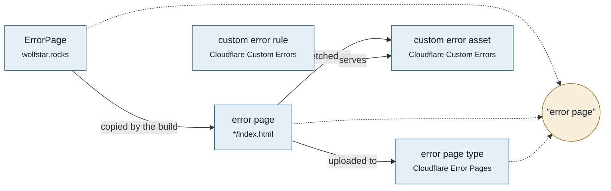

# Glossary

Canonical vocabulary for this repository. Product names come from WolfStar.rocks'
[GLOSSARY.md](https://github.com/wolfstar-project/wolfstar.rocks/blob/main/GLOSSARY.md): `WolfStar`, `WolfStar.rocks`,
`WolfStar Project`, "support server". This file adds the terms for building and serving error pages. Where
Cloudflare already named something, this file uses Cloudflare's word.

## Map

| Term               | Where it lives                                   | Owner                | Relation                                 | Customer word                 |
| ------------------ | ------------------------------------------------ | -------------------- | ---------------------------------------- | ----------------------------- |
| error page         | `*/index.html`, one entry each in `src/pages.js` | this repository      | error page 1—1 file                      | none: visitors see the page   |
| state              | `STATES` in `src/pages.js`                       | this repository      | state 1—N error page                     | none                          |
| status code        | the HTTP response                                | the response         | error page 1—1 status code, or one class | "404", "5xx", "1xxx"          |
| detail             | `cloudflare-detail`, the Ray ID badge            | this repository      | error page 0—1 detail                    | none                          |
| error token        | the page markup                                  | Cloudflare           | error page 0—N error token               | none: replaced before serving |
| Ray ID             | `::RAY_ID::`                                     | Cloudflare           | request 1—1 Ray ID                       | "Ray ID"                      |
| Error Pages        | the Cloudflare dashboard                         | Cloudflare           | Error Pages 1—N error page type          | none                          |
| error page type    | Cloudflare Error Pages                           | Cloudflare           | error page type 1—1 error page           | none                          |
| custom error asset | Cloudflare Custom Errors                         | Cloudflare           | custom error asset 1—1 error page        | none                          |
| custom error rule  | Cloudflare Custom Errors                         | Cloudflare           | custom error rule N—1 custom error asset | none                          |
| origin             | behind Cloudflare                                | WolfStar.rocks' host | zone 1—1 origin                          | none                          |
| theme              | `src/scripts/theme.js`                           | WolfStar.rocks       | visitor 1—1 theme                        | none                          |
| language           | `src/scripts/page.js`, `src/messages.js`         | WolfStar.rocks       | visitor 1—1 language                     | none                          |

Collisions

- "error page": the site's ErrorPage component is the source, an error page is one of this repository's files,
  and Error Pages is the Cloudflare feature a file is uploaded to. Write ErrorPage, error page, and Error Pages.
- "status" is the HTTP status code. "State" is which of the three layouts of the site's error page a file uses.
- "500" and "1000": `borked` and `cloudflare_errors` serve Cloudflare's "500 class errors" and "1000 class errors"
  types, so they show any 5xx or 1xxx code. A 1xxx code is Cloudflare's own error code, not an HTTP status.
- "detail": the site's ErrorPage calls the slot under the description `detail`. Cloudflare's own markup says
  "error details". Here it is the detail.

## Terms

### error page

**Is:** one `index.html` in its own directory, built from one entry in `src/pages.js`, that Cloudflare serves instead of a
response.

**Use for:** the files, the README, and code comments.

**Never:** custom page, template, error screen.

### state

**Is:** which of the three layouts of the site's error page a file uses: not found (404), server error (5xx), or
other (any other status code). It decides the icon, the icon's color, and the actions.

**Use for:** `STATES` and `page.state` in code, and docs.

**Never:** variant, kind, type (type is Cloudflare's error page type).

### status code

**Is:** the HTTP status of the response a page answers, shown above the title. `borked` shows "5xx" until its
script reads the real code from the response or from Cloudflare's detail. `cloudflare_errors` shows Cloudflare's own 1xxx
error code instead, read from the detail, because Cloudflare sends those errors with another HTTP status.

**Never:** error number, status number.

### detail

**Is:** the block under the description that shows what Cloudflare reports: its own details on `borked` and
`cloudflare_errors`, the Ray ID on the other pages that have one.

**Never:** info box, error box, debug info.

### error token

**Is:** text in a page that Cloudflare replaces before it serves the page. `::CLOUDFLARE_ERROR_500S_BOX::` inserts
Cloudflare's details and is required by the "500 class errors" type, as `::CLOUDFLARE_ERROR_1000S_BOX::` is by
"1000 class errors". `::RAY_ID::` inserts one value.

**Never:** variable, macro, shortcode.

### Ray ID

**Is:** Cloudflare's identifier for one request. A visitor can quote it in the support server.

**Casing:** `Ray ID`, untranslated in every language.

**Never:** request ID, trace ID.

### Error Pages

**Is:** the Cloudflare feature that replaces Cloudflare's own page for an error page type, per zone or for the
whole account.

**Never:** Custom Pages, the feature's older name.

### error page type

**Is:** one case Error Pages can replace, named as Cloudflare names it: "WAF block", "IP/Country block",
"IP/Country challenge", "500 class errors", "1000 class errors", "Managed challenge / I'm Under Attack Mode",
"Rate limiting block".

**Never:** page kind, slot.

### custom error asset

**Is:** a page Cloudflare fetched from a URL and stores, for custom error rules to serve.

**Never:** error asset, stored page.

### custom error rule

**Is:** a Cloudflare rule that serves a custom error asset when its expression matches, such as
`http.response.code eq 404`. A matching rule takes priority over Error Pages.

**Never:** error rule, override.

### origin

**Is:** the server behind Cloudflare that normally answers for WolfStar.rocks. Cloudflare's word.

**Never:** backend, upstream, upstream server.

### theme

**Is:** the look the visitor picked on WolfStar.rocks: light, dark, midnight, or system, and Discord's darker "Dark"
shade. A page reads it from the site's storage, and follows the system without it.

**Never:** color scheme (the CSS preference for light or dark), skin, mode.

### language

**Is:** the language the visitor chose on WolfStar.rocks. English when they chose none. The site's word.

**Never:** locale in anything a visitor reads, browser language. `locale` stays in code and in the site's locale
file paths.

## Banned

| Never                         | Use instead | Why                                               |
| ----------------------------- | ----------- | ------------------------------------------------- |
| Wolfstar, wolfStar, Wolf Star | WolfStar    | The site's casing, inherited from its GLOSSARY.md |
| Custom Pages                  | Error Pages | Cloudflare's current name for the feature         |
| upstream, backend             | origin      | Cloudflare's word for the server behind it        |
| error box, info box           | detail      | The site's name for that slot                     |

## Open questions

Naming calls this file does not settle. Resolve one, fold the answer in above, then delete it.

1. **"State" for the three layouts.** The site's ErrorPage has no name for them: it branches on `isNotFound` and
   `isServerError`. This repository calls them states, with the values `notFound`, `serverError`, and `other`.
   - Keep "state", and add it to the site's glossary if the site ever needs it.
   - Rename to whatever the site picks, if it names them first.
